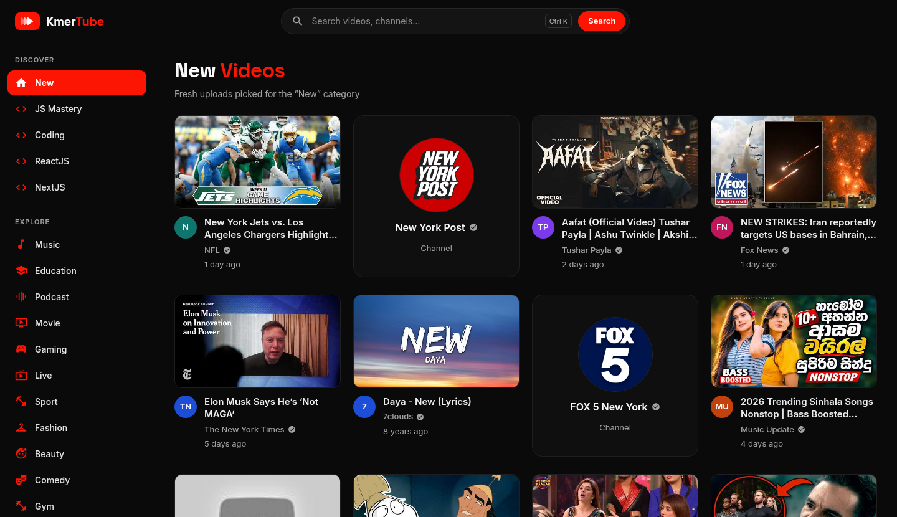
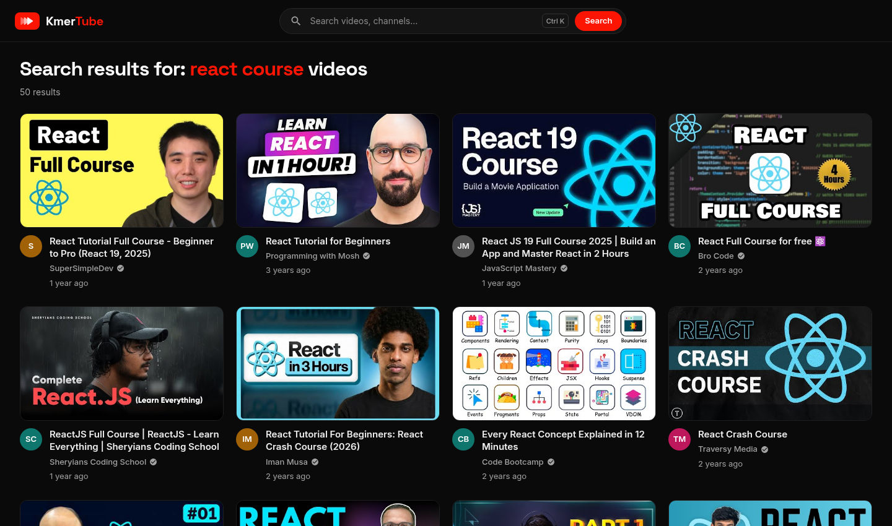
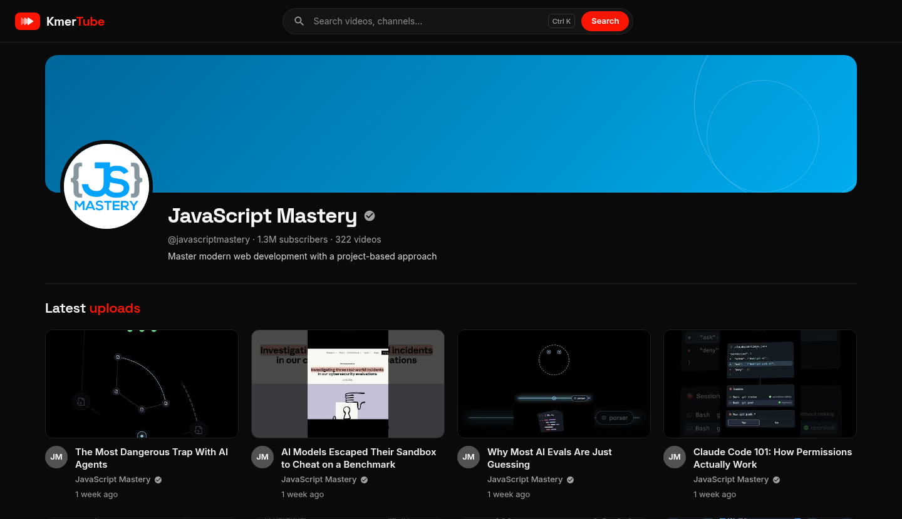
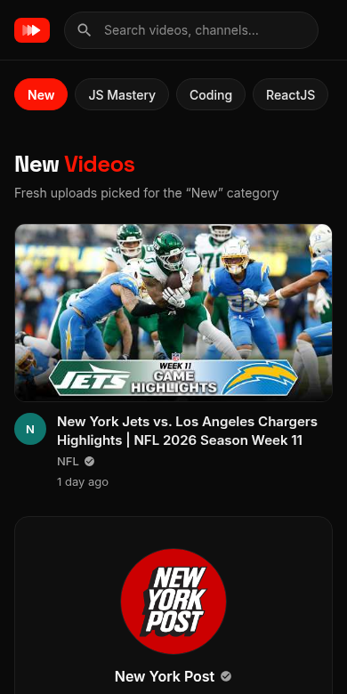

<div align="center">


# KmerTube

**A modern video streaming platform built with React 18 and Material UI.**

Browse trending videos by category, search the whole catalog, watch videos and explore channels, all in a fast, responsive, dark interface.

[**Live demo**](https://kmertube.netlify.app/) · [Report a bug](https://github.com/CodeShadowing95/yutubewatch/issues) · [Request a feature](https://github.com/CodeShadowing95/yutubewatch/issues)


</div>



## Table of contents

- [About the project](#about-the-project)
- [Features](#features)
- [Screenshots](#screenshots)
- [Tech stack](#tech-stack)
- [Architecture](#architecture)
- [Getting started](#getting-started)
- [Available scripts](#available-scripts)
- [Deployment](#deployment)
- [Roadmap](#roadmap)
- [Author](#author)
- [License](#license)

## About the project

KmerTube is a front-end video platform that consumes the YouTube Data API through [RapidAPI](https://rapidapi.com/ytdlfree/api/youtube-v31). It focuses on the parts of the experience people use every day: discovering content, searching, watching and following creators.

The interface uses its own design system: a deep black background, a signature red accent, rounded 16:9 thumbnails, skeleton loading states and a layout that adapts from a 4-column desktop grid down to a single-column mobile feed.

## Features

- **Category feed**: 17 categories (Coding, ReactJS, Music, Gaming, Podcast…), grouped into *Discover* and *Explore*, shown as scrollable pills on mobile.
- **Search**: full-text search across videos and channels, with a `Ctrl+K` / `Cmd+K` shortcut to focus the search bar from anywhere.
- **Video page**: embedded player, view and like counts, expandable description and an *Up next* list.
- **Channel page**: banner, avatar, subscriber and video counts, and the channel's latest uploads.
- **Polished states**: skeleton loaders while data loads, clear empty states, and pages that keep working when the API fails.
- **Responsive design**: tuned for desktop, tablet and mobile.
- **Clean data display**: relative publish dates ("3 days ago"), compact numbers (1.2M), decoded titles and a LIVE badge for live streams.

## Screenshots

| Video page | Search results |
| :---: | :---: |
|  |  |

| Channel page |
| :---: |
|  |

<div align="center">
  <p><strong>Mobile</strong></p>
  
</div>

## Tech stack

| Layer | Technology |
| --- | --- |
| UI library | [React 18](https://react.dev/) |
| Component library | [Material UI 5](https://mui.com/) with a custom dark theme, styled with [Emotion](https://emotion.sh/) |
| Routing | [React Router 6](https://reactrouter.com/) |
| Data fetching | [Axios](https://axios-http.com/) |
| Video player | [React Player](https://github.com/cookpete/react-player) |
| Data source | [YouTube v3 API on RapidAPI](https://rapidapi.com/ytdlfree/api/youtube-v31) |
| Typography | Inter and Space Grotesk (Google Fonts) |
| Tooling | Create React App 5, ESLint |
| Hosting | [Netlify](https://www.netlify.com/) |

## Architecture

```
src/
├── components/          # UI components, one per file
│   ├── Navbar.jsx       # Sticky header with logo and search
│   ├── SearchBar.jsx    # Search field with Ctrl+K shortcut
│   ├── Sidebar.jsx      # Category navigation (list on desktop, pills on mobile)
│   ├── Feed.jsx         # Home page: category feed
│   ├── SearchFeed.jsx   # Search results page
│   ├── VideoDetail.jsx  # Video page: player, details, up next
│   ├── ChannelDetail.jsx# Channel page: header and latest uploads
│   ├── Videos.jsx       # Responsive grid / list with loading and empty states
│   ├── VideoCard.jsx    # Video thumbnail card (grid and compact variants)
│   └── ChannelCard.jsx  # Channel card
├── utils/
│   ├── theme.js         # Design tokens and MUI theme
│   ├── format.js        # Dates, counts, avatars and HTML entity helpers
│   ├── fetchFromAPI.js  # Axios client for the RapidAPI endpoint
│   └── constants.js     # Categories and fallback data
├── App.js               # Routes
└── index.js             # Entry point: theme provider and app mount
```

| Route | Page |
| --- | --- |
| `/` | Home feed |
| `/video/:id` | Video page |
| `/channel/:id` | Channel page |
| `/search/:searchTerm` | Search results |

## Getting started

### Prerequisites

- [Node.js](https://nodejs.org/) 18 or later
- A free [RapidAPI](https://rapidapi.com/) account subscribed to the [YouTube v3 API](https://rapidapi.com/ytdlfree/api/youtube-v31)

### Installation

```bash
# 1. Clone the repository
git clone https://github.com/CodeShadowing95/yutubewatch.git
cd yutubewatch

# 2. Install dependencies
npm ci

# 3. Add your API key
cp .env.example .env
# then set REACT_APP_RAPID_API_KEY in .env

# 4. Start the development server
npm start
```

The app runs at [http://localhost:3000](http://localhost:3000).

### Environment variables

| Variable | Description |
| --- | --- |
| `REACT_APP_RAPID_API_KEY` | Your RapidAPI key for the YouTube v3 API. Required. |

> [!NOTE]
> Create React App inlines `REACT_APP_*` variables into the built JavaScript, so this key is visible to anyone using the deployed site. Use a free-tier key and set a quota on it in RapidAPI.

## Available scripts

| Command | Description |
| --- | --- |
| `npm start` | Starts the development server with hot reload |
| `npm run build` | Builds an optimized production bundle in `build/` |

## Deployment

The project deploys to Netlify. All build settings live in [`netlify.toml`](netlify.toml), so nothing has to be filled in by hand:

| Setting | Value |
| --- | --- |
| Build command | `npm run build` |
| Publish directory | `build` |
| Node version | 18 |
| SPA fallback | every route serves `index.html` |

To deploy your own copy:

1. In Netlify, choose **Add new site → Import an existing project** and pick this repository.
2. Add `REACT_APP_RAPID_API_KEY` under **Site configuration → Environment variables**.
3. Deploy. Every push to `main` then redeploys the site, and every pull request gets its own deploy preview.

## Roadmap

- [ ] Real durations and view counts on video cards
- [ ] Comments under each video
- [ ] *Watch later* and watch history, saved in the browser
- [ ] Search suggestions and recent searches
- [ ] Channel tabs (Videos, Live, Playlists, About)
- [ ] Autoplay of the next video
- [ ] Bottom navigation bar on mobile

## Author

**Frank Patrick Namegni**, full-stack web developer

- Portfolio: [patrktech.com](https://patrktech.com/)
- LinkedIn: [frank-patrick-namegni](https://www.linkedin.com/in/frank-patrick-namegni/)
- GitHub: [@CodeShadowing95](https://github.com/CodeShadowing95)

## License

Distributed under the MIT License. See [`LICENSE`](LICENSE) for details.

<sub>KmerTube is a personal portfolio project. It is not affiliated with or endorsed by YouTube or Google. Video content and metadata belong to their respective owners.</sub>
